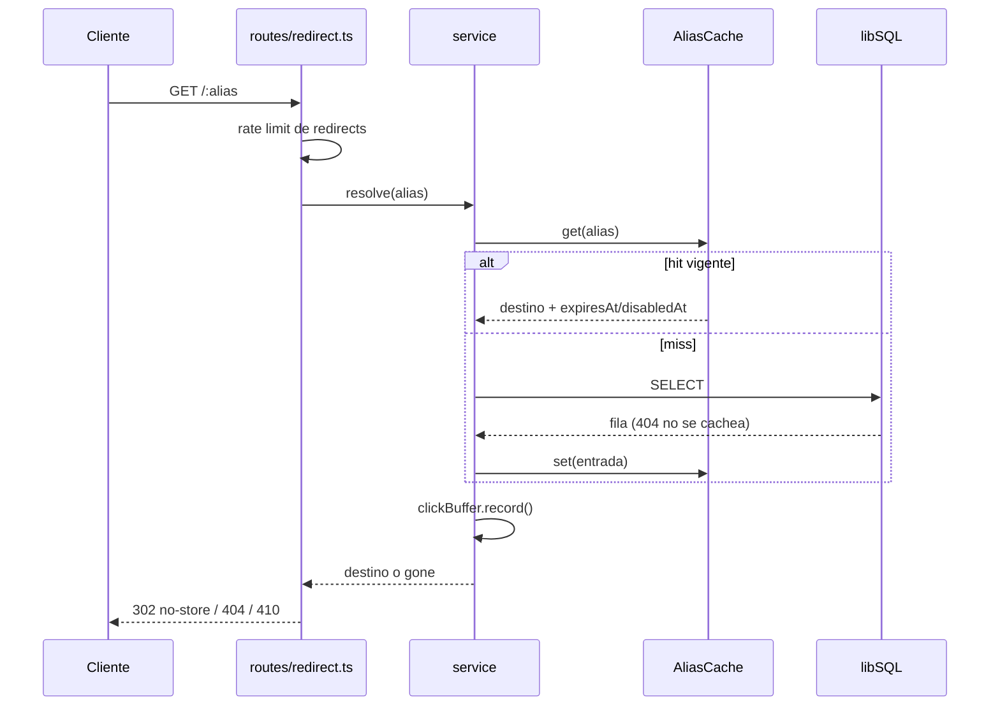
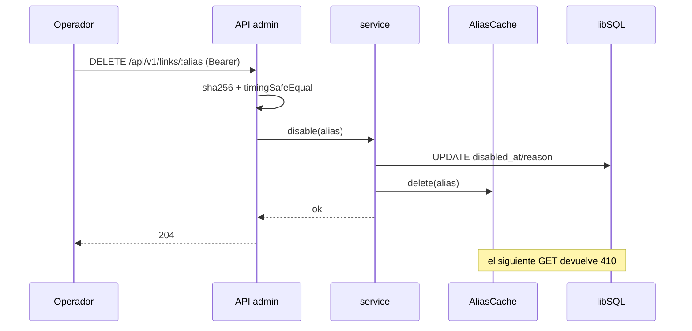
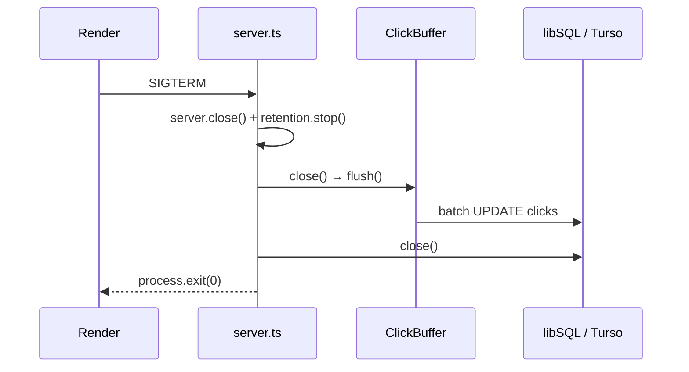

# erdl · Acortador de URLs anónimo

MVP de acortador de URLs sin cuentas. Express 5 + TypeScript estricto + libSQL
(SQLite local o Turso) con SSR, límites por IP, blocklist, honeypot firmado,
takedown administrativo, expiración y retención de IPs.

La guía de construcción por fases está en
[`plan-MVP-acortador-url.md`](./plan-MVP-acortador-url.md).

## Estado: fases 0–9 completas

| Fase | Qué aporta |
| --- | --- |
| 0 | Esqueleto, configuración Zod, `/health` |
| 1 | Esquema, migraciones idempotentes, índices |
| 2 | Validación/normalización de URL y alias |
| 3 | Servicio de enlaces y API |
| 4 | SSR, estáticos, CSP estricta |
| 5 | Caché LRU, buffer de clics, apagado limpio |
| 6 | HMAC de IP, rate limiting, cuota y dedupe |
| 7 | Blocklist, honeypot, admin, takedown |
| 8 | Alias propio, expiración y retención de IPs |
| 9 | Suite de aceptación, README y despliegue |

## Arranque local

Requisitos: Node.js 22 o superior.

```bash
npm ci
cp .env.example .env
# genera los secretos y edítalos en .env
openssl rand -hex 32   # ADMIN_TOKEN
openssl rand -hex 32   # IP_HASH_SECRET
openssl rand -hex 32   # FORM_TOKEN_SECRET (opcional)
npm run dev
```

La primera ejecución aplica `migrations/001_init.sql` sobre `file:local.db`.

Comprobaciones rápidas:

```bash
curl -s http://localhost:3000/health
# {"status":"ok"}

curl -s -X POST http://localhost:3000/api/v1/links \
  -H 'content-type: application/json' \
  -d '{"url":"https://example.com/ruta/larga"}'

curl -i http://localhost:3000/<alias>
```

## Scripts

```bash
npm run dev        # tsx watch
npm run build      # tsc a dist/
npm start          # node dist/server.js
npm run typecheck  # tsc --noEmit
npm test           # Vitest (157+ tests)
npm run test:watch
```

## Variables de entorno

| Variable | Obligatoria | Default | Uso |
| --- | --- | --- | --- |
| `BASE_URL` | Sí | — | Origen público para construir enlaces cortos |
| `ADMIN_TOKEN` | Sí | — | Bearer del admin (mín. 16 caracteres) |
| `IP_HASH_SECRET` | Sí | — | HMAC de IPs para límites, cuota y dedupe |
| `FORM_TOKEN_SECRET` | No | `ADMIN_TOKEN` | Firma del honeypot; conviene uno distinto |
| `DATABASE_URL` | No | `file:local.db` | SQLite local o `libsql://…` de Turso |
| `DATABASE_AUTH_TOKEN` | No | — | Token de Turso |
| `IP_RETENTION_DAYS` | No | `45` | Días antes de anonimizar el hash de IP |
| `TRUST_PROXY` | No | `0` | `1` detrás del proxy de Render |
| `PORT` | No | `3000` | Puerto HTTP |
| `LOG_LEVEL` | No | `info` | Nivel de pino |
| `ABUSE_CONTACT_EMAIL` | No | — | Correo visible en el pie |
| `NODE_ENV` | No | `development` | `production` activa caché estática |

## API

| Método | Ruta | Auth | Respuesta |
| --- | --- | --- | --- |
| `GET` | `/health` | — | `200 {"status":"ok"}` |
| `POST` | `/api/v1/links` | — | `201` enlace + `Location` |
| `GET` | `/api/v1/links/:alias` | — | `200` metadata, `404`, `410` |
| `GET` | `/:alias` | — | `302 no-store`, `404`, `410` |
| `POST` | `/links` | Honeypot | `303 /?created=alias` |
| `DELETE` | `/api/v1/links/:alias` | Bearer | `204`, `404` |
| `POST` | `/api/v1/admin/blocklist` | Bearer | `201` alta/actualización |

Crear con alias y expiración:

```bash
curl -s -X POST http://localhost:3000/api/v1/links \
  -H 'content-type: application/json' \
  -d '{
    "url": "https://example.com/promo",
    "alias": "promo-2026",
    "expiresAt": "2026-12-31T23:59:00.000Z"
  }'
```

La expiración debe estar entre 5 minutos y 1 año desde ahora. Un alias
duplicado devuelve `409`. Un enlace vencido o retirado devuelve `410`, nunca
`404`: existió y ya no está disponible.

El formulario SSR también acepta alias propio y una fecha de caducidad en UTC
(`<input type="datetime-local">` + etiqueta UTC para evitar ambigüedades).

## Procedimiento de takedown

El token admin nunca se registra en logs (pino redacta `Authorization` y
cookies). Todas las rutas admin responden `401` sin `Authorization: Bearer`.

1. Verificar el reporte recibido en `ABUSE_CONTACT_EMAIL`.
2. Deshabilitar el enlace (idempotente, no borra la fila):

   ```bash
   curl -i -X DELETE http://localhost:3000/api/v1/links/ALIAS \
     -H "Authorization: Bearer $ADMIN_TOKEN"
   ```

   El siguiente `GET /ALIAS` devuelve `410` de inmediato porque el takedown
   invalida la entrada de caché. La fila no se borra: el alias queda reservado
   (no puede reutilizarse) y el `410` conserva la diferencia entre «nunca
   existió» (`404`) y «existió y fue retirado» (`410`).

3. Si el dominio es reincidente, bloquearlo y todos sus subdominios:

   ```bash
   curl -s -X POST http://localhost:3000/api/v1/admin/blocklist \
     -H "Authorization: Bearer $ADMIN_TOKEN" \
     -H 'content-type: application/json' \
     -d '{"domain":"dominio-malicioso.example"}'
   ```

   Para desactivar una entrada sin borrarla: enviar `{"enabled":false}`.
   El alta manual invalida la caché de blocklist (TTL normal: 60 s).

4. Documentar la decisión (fecha, alias, dominio, motivo) en el canal interno.

La blocklist parte de `seed/blocklist.json` (acortadores y redirectores
conocidos) y añade el propio dominio de `BASE_URL` para evitar bucles. Solo
impide **crear** enlaces nuevos: los enlaces ya existentes se retiran con
`DELETE /api/v1/links/:alias`.

## Retención y privacidad

- La IP se guarda como `HMAC-SHA256(IP_HASH_SECRET, IPv4 o prefijo /64 IPv6)`.
- `jobs/retention.ts` corre al arrancar y cada 6 h: pone `created_ip_hash = NULL`
  en filas con `created_at` anterior a `IP_RETENTION_DAYS`.
- **Consecuencia consciente:** esas filas dejan de contar para la cuota y el
  dedupe de esa IP. Es una decisión de privacidad, no un bug.

## Límites de abuso

- Crear: 5/min, 30/h y 100/día por IP + 500/h global.
- Redirects: 300/min por IP.
- Cuota: 50 enlaces activos por IP.
- Dedupe: misma URL normalizada + misma IP en 24 h devuelve el alias existente.
- Formulario: token HMAC (`timestamp.firma`) con antigüedad mínima de 3 s,
  máximo 2 h, campo trampa `website` y rechazo genérico.
- Blocklist: dominio registrable con `tldts`; bloquea subdominios, no sufijos
  parecidos (`example.co.uk` ≠ `notexample.co.uk`).

## Despliegue en Render

`render.yaml` define el servicio. Pasos:

1. Crear una base en Turso y copiar `libsql://…` y el auth token.
2. En Render, crear un Blueprint desde el repositorio.
3. Rellenar los secretos marcados `sync: false` (`BASE_URL`,
   `DATABASE_URL`, `DATABASE_AUTH_TOKEN`, `ABUSE_CONTACT_EMAIL`).
4. Dejar `TRUST_PROXY=1` y `IP_RETENTION_DAYS=45`.
5. Verificar `/health` y crear un enlace de prueba.

El plan `free` de Render duerme la instancia; este MVP asume **una sola
instancia always-on** porque caché, rate limiter y buffer de clics viven en
memoria. Usa el plan `starter` o superior.

Render envía `SIGTERM` en cada deploy. El orden del apagado es:
dejar de aceptar conexiones → detener retención → vaciar buffer de clics →
cerrar DB → salir. Un crash duro puede perder hasta ~5 s de clics.

## Flujo del sistema (trazas A–D)

### A. Crear un enlace por API


### B. Redirect



### C. Takedown



### D. Deploy con clics pendientes



## Criterios de aceptación cubiertos

La suite está en `src/**/*.test.ts`:

- Health, CSP, estáticos y 404 HTML/JSON → `src/app.test.ts`.
- Crear por API/formulario, alias duplicado, 410, XSS → `src/app.test.ts`.
- Dedupe, cuota, rate limit 429 + `Retry-After` → `src/app.test.ts`,
  `src/links/service.abuse.test.ts`, `src/abuse/rate-limit.test.ts`.
- 300 resoluciones = 1 lectura, TTL, 404 no cacheado → `src/links/service.abuse.test.ts`.
- Blocklist semilla/manual, subdominios, TTL 60 s → `src/abuse/blocklist.test.ts`.
- Honeypot manipulado/ausente/rápido → `src/abuse/form-token.test.ts` y
  `src/app.test.ts`.
- Token admin constante e invalidez → `src/abuse/admin-auth.test.ts`;
  redacción de logs → `src/logger.test.ts`.
- Takedown invalida caché → `src/app.test.ts`.
- Retención y su efecto en cuota → `src/jobs/retention.test.ts`.
- SIGTERM persiste clics → `src/server.shutdown.test.ts`.

## Limitaciones conocidas

- Estado en memoria: caché, rate limiter y buffer se pierden en cada deploy y
  no se comparten entre instancias. Una sola instancia always-on.
- Un crash duro (no `SIGTERM`) puede perder hasta ~5 s de clics.
- La blocklist tarda hasta 60 s en reflejar cambios hechos directamente en la
  DB; el endpoint admin invalida la caché al instante.
- El honeypot frena bots simples, no humanos ni ataques dirigidos. La defensa
  real son las cuotas IP/globales y la blocklist.
- No hay cuentas ni recuperación de enlaces: `/?created=<alias>` solo muestra
  datos públicos y cualquiera puede fabricarlo.
- No hay formulario de reporte; el canal es `ABUSE_CONTACT_EMAIL` y el
  procedimiento de takedown de arriba.
